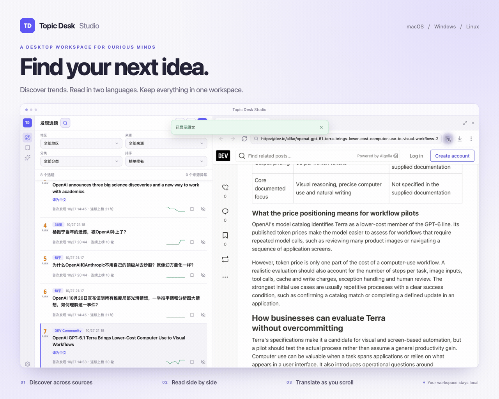

# Topic Desk Studio

A desktop workspace for discovering trending topics, keeping a creation queue, and reading the original pages side by side. Your workspace stays on your device; no Topic Desk account is required.

[English](./README.md) · [简体中文](./README.zh-CN.md) · [Download](https://github.com/microai-lab/topic-desk-studio/releases/latest)

<p>
  
  <a href="https://github.com/microai-lab/topic-desk-studio/releases/latest"></a>
  <a href="./LICENSE"></a>
</p>

<p>
  <a href="./assets/topic-desk-studio-hero.png"></a>
</p>

<p align="center"><a href="./assets/topic-desk-studio-hero.png">View high-resolution screenshot</a></p>

## What you can do

- **Discover topics across sources.** Built-in sources include Hacker News, GitHub, Hugging Face, Google Trends, Weibo, Zhihu, and Bilibili, covering news, technology, finance, and developer communities.
- **Follow trends.** Filter by source, region, category, or title keyword; sort by rank or update time; see rank changes, trend lines, first-seen time, and consecutive chart appearances.
- **Keep a creation queue.** Save promising topics even after they leave a live chart. Hide unwanted topics from future collections and restore them when needed.
- **Read without leaving your workspace.** Open original pages in the right-hand pane, use multiple tabs, resize or expand the reader, search within a page, and manage downloads.
- **Translate on demand.** Translate English titles into Chinese or read bilingual pages with translations beneath the original text, continuing as you scroll.
- **Make it your own.** Manage and reorder sources, add custom feeds, import or export source configurations, choose Chinese or English, and use light, dark, or system themes.

## Install

Download the package for your device from [GitHub Releases](https://github.com/microai-lab/topic-desk-studio/releases/latest).

| Platform | Choose |
| --- | --- |
| macOS | `.dmg` for Apple Silicon (`aarch64`) or Intel (`x64`) |
| Windows | x64 `.exe` or `.msi` installer |
| Linux | x64 `.AppImage` or the package available for your distribution |

### macOS launch warnings

Unsigned downloads may be blocked by macOS. Confirm that the package came from this repository's release page before allowing it to run. If macOS reports that the app is “damaged,” download it again first; the warning alone does not establish that the file is intact.

For a verified download installed in `/Applications`, you can remove the quarantine flag for this app:

```bash
xattr -d com.apple.quarantine /Applications/Topic\ Desk\ Studio.app
```

## Your first workflow

1. Open **Discover** and click **Collect**. Collection also starts automatically after launch and refreshes about every 10 minutes while the app is running. A failing source does not stop other sources from updating.
2. Select a source such as **Hacker News**, narrow the results with filters or search, and use **Recent additions** to find newly collected topics.
3. Click **Add to queue** to keep a topic for later. Open **Queue** to revisit your saved topics.
4. Open a topic's original link to read it in the right-hand pane. Use the address bar to open another page, expand the reader for more space, or switch between tabs. The downloads button shows transfer status and lets you open completed files or their folders; cancelling active downloads is supported on macOS.
5. Choose **Hide permanently** for topics you no longer want to see. You can find and restore individual topics, or restore all of them, in **Settings → Local data → Hidden topics**.

## Sources and local data

In **Settings → Sources**, enable or disable individual sources, edit their settings, drag to reorder them, or add a custom RSS, JSON, or HTML source. Import and export one source or the full list to reuse your setup. **Restore defaults** resets built-in sources while retaining custom sources and historical topics.

Public feeds can become unavailable when sites change or restrict access. If MIT Technology Review’s official feed is unavailable, the app can use Bing’s public news index to recover article headlines and original links. Indexed results may be delayed or incomplete. Check the source's latest status and error details, and configure a collection proxy in **Settings → General** when needed.

**Settings → Local data** shows storage health and offers cleanup, local backup, and restoration of the latest backup. The app keeps the three most recent backups. Restoring replaces current local data; downloaded files are retained.

## Optional translation

Open **Settings → Translation**, choose a provider, and save the endpoint, model, and API key if required. Presets include cloud providers and local Ollama; custom OpenAI-compatible endpoints and Anthropic are supported. The default endpoint is `https://api.deepseek.com` with model `deepseek-flash`. A supported local endpoint can be used without an API key.

- **Titles:** click **Translate** on an eligible English title to translate it into Simplified Chinese.
- **Pages:** click the translation button in the reader toolbar. Visible text is translated first, with translations shown beneath the original and more content translated as you scroll. Choose a target language in the reader's **Browser settings**, and use **Show original page** in its menu to stop translation and restore the original.

Translation runs only when you request it. Selected titles and page text encountered during translation are sent to your configured model service, which may apply its own usage limits and charges.

## Data and privacy

- Topics, your queue, source configurations, settings, and saved browsing/download records stay on your device. The app does not upload your creation queue or require an account.
- Collection contacts the enabled sources; opening a page contacts that website. Optional translation sends the selected title or visible page text to the configured model service.
- API keys are encrypted locally and are never exposed to pages.
- Reading tabs share a temporary website session while the app is running, including after closing and reopening a tab. Other website data is discarded when you clear site data or exit the app. Login cookies are encrypted locally and restored when you reopen a tab or restart the app. Cookies without a website expiry are remembered for up to 30 days. Clearing cookies removes remembered logins from all tabs; website expiry or revocation may still require signing in again. The app does not save or autofill passwords. You can disable saved browsing history and clear local browsing/download records from the reader; clearing download records does not delete downloaded files.

Topic Desk Studio is the standalone desktop edition of [dsh-topic-desk](https://github.com/microai-lab/dsh-topic-desk).

## License

[MIT](./LICENSE) © 2026 MicroAI Lab
