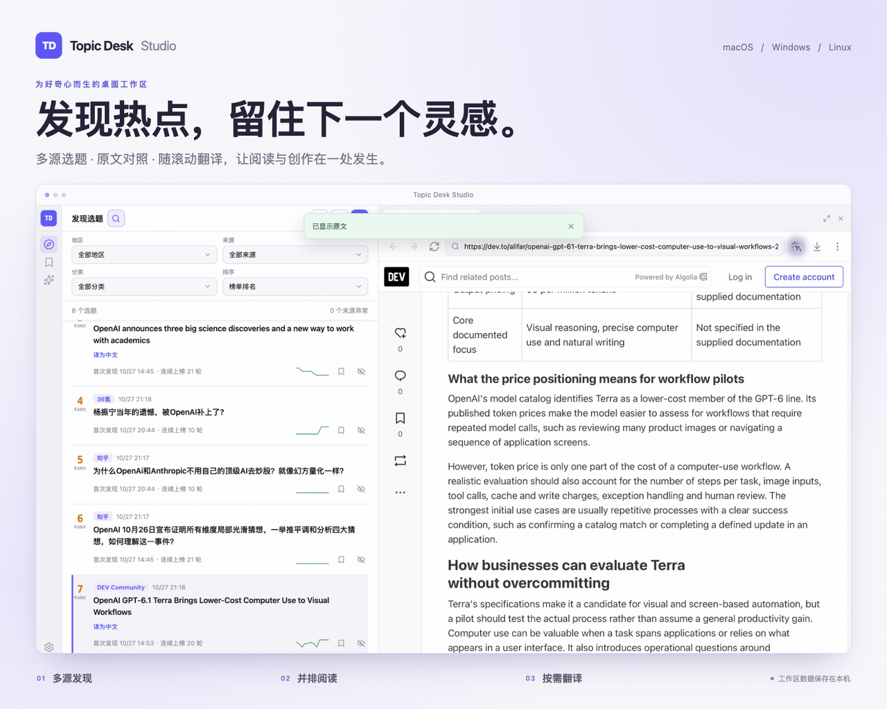

# Topic Desk Studio

**发现热点，留下值得创作的选题。**

为内容创作者、编辑和资讯读者打造的桌面话题工作台。从多来源发现热点、整理待创作选题，到对照原文与译文，在同一个工作区完成。

[English](./README.md) · [简体中文](./README.zh-CN.md) · [下载安装](https://github.com/microai-lab/topic-desk-studio/releases/latest)

<p>
  
  <a href="https://github.com/microai-lab/topic-desk-studio/releases/latest"></a>
  <a href="./LICENSE"></a>
</p>

<p>
  <a href="./assets/topic-desk-studio-hero-zh.png"></a>
</p>

<p align="center"><a href="./assets/topic-desk-studio-hero-zh.png">查看高清静态截图</a></p>

## 下载安装

前往 [GitHub Releases](https://github.com/microai-lab/topic-desk-studio/releases/latest) 下载最新安装包。

| 平台 | 安装包 |
| --- | --- |
| macOS | Apple Silicon（`aarch64`）或 Intel（`x64`）对应的 `.dmg` |
| Windows | x64 `.exe` 或 `.msi` |
| Linux | x64 `.AppImage`，或对应发行版的安装包 |

<details>
<summary>macOS 首次启动提示</summary>

macOS 可能拦截未签名的下载文件。请确认安装包来自本仓库的发布页；如果提示“已损坏”，请先重新下载。

确认下载可信且应用已安装到 `/Applications` 后，可移除这个应用的隔离标记：

```bash
xattr -d com.apple.quarantine /Applications/Topic\ Desk\ Studio.app
```

</details>

## 从热点列表，到值得留下的选题

| 你的工作流 | Topic Desk 能做什么 |
| --- | --- |
| **寻找切入点** | 把新闻、AI 动态、社交热点与社区讨论汇集到一个列表，按来源、地区、分类或关键词筛选。 |
| **追踪话题** | 查看排名变化、趋势折线、首次发现时间与连续上榜轮次，通过 **最近新增** 找到刚采集的内容。 |
| **整理选题** | 把有价值的话题加入 **待创作**，离榜后仍可保留；隐藏不感兴趣的话题，需要时再恢复。 |
| **阅读与理解** | 在列表旁打开原文，多标签切换；译文显示在原文下方，随滚动继续翻译。 |

内置微博、知乎、B 站、36氪、TechCrunch、The Verge、Google Trends、Hacker News 等来源，也覆盖 GitHub、Hugging Face 等开发者社区。可以按兴趣选择来源、添加自己的订阅，并切换中英文界面与浅色、深色或随系统主题。

## 快速上手

1. **采集话题。** 打开 **发现选题**，点击 **采集数据**。启动后也会自动采集，运行期间约每 10 分钟刷新一次；单个来源失败不会影响其他来源更新。
2. **聚焦感兴趣的内容。** 搜索 `OpenAI` 等关键词，或按来源、分类筛选。
3. **保存值得跟进的选题。** 点击 **加入待创作**，稍后在 **待创作** 中集中回看。
4. **打开原文。** 点击标题，在右侧阅读区继续阅读。可调整宽度、打开多个标签页，或点击 **收起选题** 专注阅读；通过 **展开选题** 恢复列表及原来的分栏宽度。收起后可通过窄侧栏的短线浏览当前话题，悬停显示标题与来源，点击在阅读区新页签中打开。

正在播放媒体的页签会显示喇叭图标，点击即可静音或取消静音，后台页签也适用。阅读区还支持页内查找与下载管理，可打开已下载文件及所在文件夹；macOS 支持取消进行中的下载。

## 双语阅读

先在 **设置 → 翻译模型** 中选择服务商，保存接口地址、模型名称和所需的 API Key。支持云端服务、Anthropic、自定义 OpenAI 兼容接口与本地 Ollama；受支持的本地接口可以不配置 API Key。

- **文章页面：** 点击阅读区工具栏中的翻译按钮，优先翻译当前可见内容，译文显示在原文下方，随滚动继续翻译。再次点击同一按钮即可恢复原文。
- **英文标题：** 在符合条件的标题上点击 **译为中文**，生成简体中文译文。
- **目标语言：** 在阅读区的 **浏览器设置** 中选择。

DeepSeek 官方接口优先直连；建立连接失败时，会通过“设置 → 网络代理”中保存的代理重试一次。本地模型保持直连。

翻译仅在主动操作后启动。所选标题或翻译过程中阅读到的页面文本会发送给配置的模型服务；服务商可能有自己的用量限制与费用。

## 配置自己的工作台

- **来源 — 设置 → 数据来源：** 启停、编辑与排序来源，添加 RSS、JSON、HTML 来源，导入导出单个来源或全部配置。点击 **连通性测试** 检查所有来源（含已停用来源），或点击每行的连通性图标单独测试；每次测试都会重新自动判断本次连接方式，使用已保存的代理地址且不新增选题、不修改来源设置，全部完成后弹窗汇总结果。**恢复默认来源** 会保留自定义来源和历史话题。
- **代理 — 设置 → 网络代理：** 选择已保存的代理或编辑地址。采集失败时，可查看来源最近的状态与错误信息。
- **存储 — 设置 → 本地数据：** 查看存储状态、整理记录、创建或恢复本地备份。应用保留最近三份备份；恢复会覆盖当前本地数据，并保留已下载文件。
- **隐藏话题 — 设置 → 本地数据 → 已隐藏话题：** 搜索并恢复单条话题，或全部恢复。

公开来源可能因网站改版或访问限制而暂时不可用。MIT Technology Review 官方订阅不可用时，应用会尝试通过 Bing 公开新闻索引补充标题与原文链接；结果可能延迟或不完整。部分网站仍要求登录、人机验证，或在其 App 内查看内容。

## 来源连接常见问题

来源连接不上时，可参考以下常见问题排查。每次单项或全局测试都会重新自动判断本次连接方式，无需先修改来源的网络方式：

1. **保存实际代理地址。** 在 **设置 → 网络代理** 保存代理软件实际使用的 HTTP 代理地址，确认软件已运行且端口一致。7897、1082 只是预设，不会自动扫描或切换端口。
2. **直接测试。** 点击来源同行的连通性图标，或点 **连通性测试** 检查全部来源。查看本次实际的 **直连／代理** 方式；成功换用另一种方式时会提示 **自动切换**。每次测试都会重新判断，不会修改来源设置、选题或采集记录。
3. **按需要选择优先方式。** 每次手动或定时采集都会自动恢复连接：先用来源选择的方式，连接失败再尝试另一种；都失败时记录报错，继续下一个来源。在来源编辑中可选择“自动判断”“优先直连”或“优先代理”，无需逐个开启恢复。

**何时切换？** 每次采集先用来源选择的优先方式；连通性测试先按来源默认方式连接。遇到 TLS（安全连接）、连接重置、超时或 DNS（找不到网站地址）等连接问题，且已保存代理地址时，会尝试另一种方式一次。HTTP 403（网站拒绝访问）、429（请求过多）或数据格式错误不会触发切换。本机及局域网地址保持直连；没有保存代理地址时仅尝试直连。全部失败后继续其他来源，不修改已保存的设置。

<details>
<summary>展开全部 11 个问题与操作步骤</summary>

### 来源连接不上，先做什么？

每次点击单项或全局连通性测试，都会重新自动判断本次连接方式，不必先修改来源的“网络方式”。测试不新增选题、不改来源设置，也不会覆盖采集记录。上次采集与本次测试是不同请求，可能出现不同报错。

1. 在“设置 → 网络代理”保存代理软件实际使用的 HTTP 代理地址，确认软件已运行且端口一致。没有保存代理地址时，只能测试直连。
2. 点击出错来源旁的测试图标，或点“连通性测试”检查全部来源。查看本次实际的“直连／代理”方式及“自动切换”提示。
3. 正式采集也会自动尝试恢复连接，无需额外开启。测试与采集是不同时间的请求，仍失败时反馈来源名称、报错及测试结果。

### 提示“TLS 安全连接失败”或“连接被远端重置”，怎么办？

TLS 是安全连接；失败表示连接没能完成。“被远端重置”表示连接被中途断开。网络、网站或代理都可能有关，仅凭这个提示无法确定具体原因。每次测试先按来源默认方式连接；遇到这类连接问题且已保存代理地址时，会尝试另一种方式一次。

1. 在“设置 → 网络代理”保存代理软件实际使用的 HTTP 代理地址，确认软件已启动，地址和端口一致；7897、1082 只是预设，不会自动查找可用端口。
2. 直接点击量子位或出错来源旁的连通性图标测试，无需先改成“自动判断”。查看实际的“直连／代理”方式，成功换用另一种方式时会提示“自动切换”。
3. 每次采集也会自动恢复连接；可在来源右侧铅笔“编辑”中选择“优先直连”或“优先代理”来调整首次尝试顺序。保留证书校验；仍失败时用浏览器对比，检查系统时间或反馈报错，不要跳过安全警告。

### 提示“超时”或“DNS 失败”，怎么办？

超时表示等了太久还没收到完整结果。DNS 失败表示没找到网站的网络地址，可能是网络暂时异常或网址有误，不一定是来源失效。

1. 先确认其他网站能打开，再单独重测这个来源一次。
2. 检查已保存的代理地址和软件是否运行。每次测试都会自动判断，超时或 DNS 等连接问题可触发一次换路尝试；结果显示本次实际的直连／代理方式，不会修改已保存的优先顺序。
3. 在浏览器打开同一地址对比，检查网址是否拼错；稍后仍失败时反馈来源、报错和测试结果。

### 测试正常，采集却失败？采集会自动恢复连接吗？

每次手动、启动或定时采集都会重新尝试恢复连接，不必单独开启。“优先直连”和“优先代理”决定先试哪一种，“自动判断”按来源默认方式先试；遇到连接问题再尝试另一种。两种方式均失败后记录错误并继续下一个来源，不改写来源设置。本机及局域网地址保持直连；未保存代理地址时只尝试直连。

1. 在“设置 → 网络代理”保存实际运行的 HTTP 代理地址，再点击单项或全局测试。7897、1082 只是预设，软件必须已启动且端口一致；应用不会扫描端口，也不会自动改用另一预设。
2. 在“设置 → 数据来源”点右侧铅笔“编辑”，可调整网络方式的优先顺序；自动恢复对所有来源生效，无需逐个修改为“自动判断”。
3. 测试结果显示实际的直连／代理方式及“自动切换”提示；采集耗尽可用方式后仍失败时，会记录该来源报错并继续其他来源，不会反复重试。

### 提示“HTTP 401／403”或要求人机验证，怎么办？

HTTP 401／403 表示网站拒绝访问，可能需要登录、权限或验证。“自动判断”不会因为这类访问限制或验证页面切换网络方式；换代理也不保证解决。浏览器登录成功，不代表采集地址一定能访问。

1. 先在浏览器打开来源，按网站提示检查登录或验证，不要连续重复测试验证页。
2. 如果测试经过代理，确认代理运行且设置已保存；不要把反复换节点当作解决办法。
3. 优先使用网站公开的 RSS/API（订阅或数据地址）。小红书等来源使用“登录采集”；其他内置来源持续失败时反馈来源和报错。

### 提示“HTTP 429”，为什么越测试越失败？

HTTP 429 表示请求过多，网站暂时限制了访问。反复点击测试或同时采集会增加请求量，同一网络的其他使用者也可能共用限额。“自动判断”不会因为 429 切换网络方式。

1. 先停止重复测试和采集；网站给出等待时间时，按提示等待。
2. 等待后只单独测试该来源一次，避免与采集同时进行。
3. 仍受限时在浏览器查看网站提示，稍后再试或反馈来源和报错，不要靠反复切代理重试。

### 提示“HTTP 5xx”，是应用坏了吗？

HTTP 5xx 表示网站或中间服务暂时出错，网站本身、网络中间环节或代理都可能有关，不能仅凭这个数字断定是应用的问题。“自动判断”不会因为这类网站返回的错误切换网络方式。

1. 稍等后只重测这个来源一次，避免频繁刷新。
2. 如果结果显示“代理”，确认代理软件运行且地址端口已正确保存。
3. 在浏览器打开同一地址对比；仍失败时稍后再试，反馈来源、完整报错和直连／代理标记。

### 提示“HTTP 404／410”或“地址无效”，怎么办？

这通常表示找不到采集地址，它可能已经更换、停止提供，或跳转到了不可用的位置。也有网站会用这类提示限制访问。

1. 单独重测一次；如果刚修改来源，确认已经保存，并检查网址是否拼错。
2. 自定义来源可到网站官方页面确认最新的 RSS/API（订阅或数据地址），更新后保存再测；不要随意换成网站首页。
3. 内置来源不需要自行修改规则。持续失败时反馈来源名称和报错，等待后续适配。

### 网站能打开，却提示“数据格式无效”或“未解析到有效热点”，怎么办？

网站可以访问，不代表应用拿到的是选题列表。网站可能改版，或返回了登录、验证页面，导致应用暂时读不出标题。“自动判断”不会因为数据格式错误切换网络方式。

1. 先单独重测该来源，并在浏览器查看是否要求登录或验证。
2. 内置来源不需要研究技术配置；持续失败时反馈来源和完整报错，等待应用适配。
3. 仅自定义来源需核对 RSS/API（订阅或数据地址）是否正确；熟悉高级配置时再检查内容类型、标题和链接的读取规则，修改后保存再测。

### 显示“连接正常，暂无数据”，为什么没有新选题？

这表示本次连接完成，但没有读到可展示的选题。来源可能暂时没内容，也可能改版了，不能保证下次采集一定有数据。

1. 在浏览器查看来源是否有最新内容，再单独测试一次。
2. 如果是自定义来源，先核对采集地址；高级读取规则不确定时保留原配置，不必盲目修改。
3. 稍后再试；来源明明有内容却一直为空时，反馈来源名称和测试结果。

### 浏览器能打开，为什么采集失败？小红书也需要重登录吗？

浏览器可以使用登录状态、加载完整页面并完成验证；普通来源的采集不使用这些网页登录状态。小红书需通过“登录采集”检查，“需在网页中测试”不表示已退出登录。

1. 在内置浏览器打开来源，确认是否需要登录或人机验证。
2. 小红书点击来源旁的“登录采集”实际检查；首页仍显示已登录时，不必只因测试提示而重新登录。
3. 其他来源核对网站公开的 RSS/API（订阅或数据地址）；网页正常但采集仍失败时，反馈来源及报错。

</details>

## 数据与隐私

- **工作台数据保存在本机。** 话题、待创作列表、设置、来源配置，以及保存的浏览和下载记录均保留在本地。无需注册 Topic Desk 账户，应用不上传待创作列表。
- **联网行为对应具体功能。** 采集会访问启用的来源，连通性测试会访问所选来源，阅读会访问原文网站，可选翻译会访问配置的模型服务。
- **API Key 在本地加密保存，** 不会暴露给页面。
- **关闭标签页或重启应用后可恢复登录 Cookie。** Cookie 在本地加密保存，不进入备份；没有网站过期时间的 Cookie 最多保留 30 天。网站过期或撤销会话后仍可能需要重新登录。清除 Cookie 会移除所有阅读标签页中已记住的登录。
- **其他网站存储为临时数据。** macOS 阅读标签页在单次运行中共享临时会话；清除网站数据或退出应用后，其他网站数据会被丢弃。应用不保存或自动填充密码。
- **浏览历史可以关闭。** 阅读区支持关闭历史保存、清除浏览或下载记录；清除下载记录不会删除已下载文件。

Topic Desk Studio 是 [dsh-topic-desk](https://github.com/microai-lab/dsh-topic-desk) 的独立桌面版。

## 许可证

[MIT](./LICENSE) © 2026 MicroAI Lab
