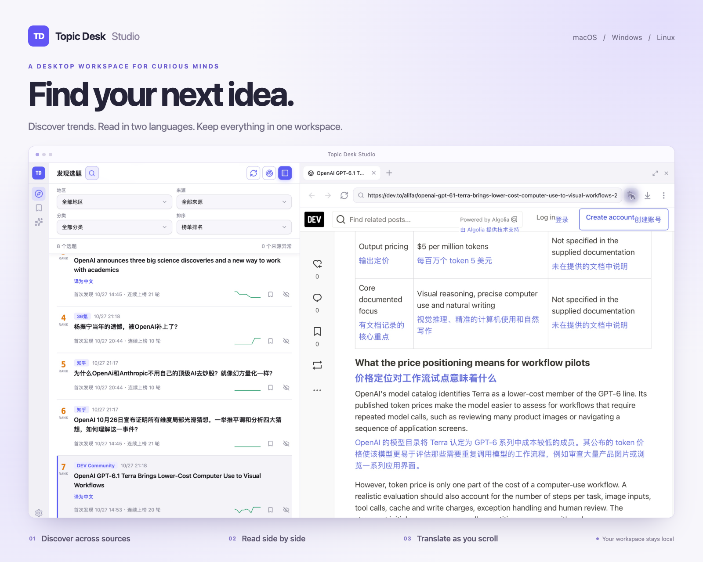

# Topic Desk Studio

把热点发现、待创作整理与原文阅读放在同一个桌面工作区。数据保存在本机，无需注册 Topic Desk 账户。

[English](./README.md) · [简体中文](./README.zh-CN.md) · [下载安装](https://github.com/microai-lab/topic-desk-studio/releases/latest)

<p>
  
  <a href="https://github.com/microai-lab/topic-desk-studio/releases/latest"></a>
  <a href="./LICENSE"></a>
</p>

<p>
  
</p>

## 可以做什么

- **汇集多个来源。** 内置 Hacker News、GitHub、Hugging Face、Google Trends、微博、知乎、B 站等来源，覆盖新闻、科技、财经与开发者社区。
- **筛选与追踪趋势。** 按来源、地区、分类、标题关键词筛选，按榜单排名或最近更新排序，并查看排名变化、趋势折线、首次发现时间和连续上榜轮次。
- **整理待创作选题。** 收藏有价值的话题，退出实时榜单后仍可保留；隐藏不感兴趣的话题，后续采集会跳过相同内容，也可随时恢复。
- **在工作区内阅读原文。** 右侧阅读区支持多标签页、调整宽度、放大阅读、页内查找和下载管理。
- **按需翻译。** 将英文标题译为中文，或在网页原文下方显示译文，随滚动继续翻译。
- **配置自己的工作区。** 管理与排序数据来源、添加自定义订阅、导入导出来源配置，并选择中英文界面及浅色、深色、随系统主题。

## 下载安装

前往 [GitHub Releases](https://github.com/microai-lab/topic-desk-studio/releases/latest)，选择适合设备的安装包。

| 平台 | 安装包选择 |
| --- | --- |
| macOS | Apple Silicon（`aarch64`）或 Intel（`x64`）对应的 `.dmg` |
| Windows | x64 `.exe` 或 `.msi` 安装程序 |
| Linux | x64 `.AppImage`，或发布页提供的对应发行版安装包 |

### macOS 首次启动提示

macOS 可能拦截未签名的下载文件。允许应用运行前，请确认安装包来自本仓库的发布页。如果提示“已损坏”，请先重新下载；不能仅凭这一提示判断文件本身是否完好。

确认下载可信且应用已安装到 `/Applications` 后，可仅移除这个应用的隔离标记：

```bash
xattr -d com.apple.quarantine /Applications/Topic\ Desk\ Studio.app
```

## 从发现到阅读

1. 打开 **发现选题**，点击 **采集数据**。应用启动后也会自动采集，运行期间约每 10 分钟刷新一次；单个来源失败不会阻止其他来源更新。
2. 选择 **Hacker News** 等来源，通过筛选或搜索缩小范围，也可在 **最近新增** 查看新采集到的话题。
3. 点击 **加入待创作** 保存选题，在 **待创作** 中集中回看。
4. 打开话题原文，在右侧阅读区继续阅读。地址栏可以打开其他网页，多标签页方便切换，放大阅读区可以获得更多空间。下载按钮可查看传输状态、打开已完成文件及所在文件夹；macOS 还支持取消进行中的下载。
5. 对不感兴趣的话题选择 **不再显示**。在 **设置 → 本地数据 → 已隐藏话题** 中，可以搜索并恢复单条话题，也可以全部恢复。

## 来源与本地数据

在 **设置 → 数据来源** 中，可以单独启停、编辑来源，拖动调整顺序，或添加自定义 RSS、JSON、HTML 来源。支持导入导出单个来源或全部配置，方便复用自己的来源列表。**恢复默认来源** 会重置内置来源，并保留自定义来源和历史话题。

公开来源可能因网站改版或访问限制而暂时不可用。可查看来源最近的状态与错误信息，必要时在 **设置 → 通用** 中配置采集代理。

**设置 → 本地数据** 可查看存储状态、整理历史记录、创建本地备份并恢复最近备份。应用保留最近三份备份；恢复会覆盖当前本地数据，但保留已下载的文件。

## 可选翻译

在 **设置 → 翻译模型** 中选择服务商，保存接口地址、模型名称，以及所需的 API Key。预设覆盖云端服务与本地 Ollama，也支持自定义 OpenAI-compatible 接口和 Anthropic。默认接口为 `https://api.deepseek.com`，默认模型为 `deepseek-flash`；受支持的本地接口可以不配置 API Key。

- **标题翻译：** 在符合条件的英文标题上点击 **译为中文**，生成简体中文译文。
- **页面翻译：** 点击阅读区工具栏中的翻译按钮，优先翻译当前可见内容，译文显示在原文下方，随滚动继续翻译。在阅读区的 **浏览器设置** 中选择目标语言，通过菜单中的 **显示页面原文** 停止翻译并恢复原文。

翻译仅在主动操作后启动。所选标题与翻译过程中阅读到的页面文本会发送给配置的模型服务；服务商可能有自己的用量限制与费用。

## 数据与隐私

- 话题、待创作列表、来源配置、设置，以及保存的浏览和下载记录均保留在本机。应用不上传待创作列表，也不要求注册账户。
- 采集会访问启用的来源，打开网页会访问对应网站；可选翻译会将所选标题或可见页面文本发送给配置的模型服务。
- API Key 在本地加密保存，不会暴露给页面。
- 网站会话使用临时存储。可在阅读区关闭浏览历史保存、清除本地浏览或下载记录；清除下载记录不会删除已下载文件。

Topic Desk Studio 是 [dsh-topic-desk](https://github.com/microai-lab/dsh-topic-desk) 的独立桌面版。

## 许可证

[MIT](./LICENSE) © 2026 MicroAI Lab
